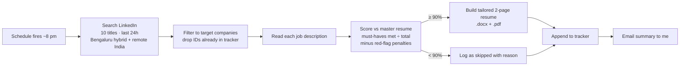

# Job-Fit Agent

An evening agent that reads the day's job postings, scores each one strictly against my real experience, and builds a tailored resume only for the roles worth applying to. It never applies on my behalf: it does the reading, I make the decision.

Built and run on **Claude (Claude Agent SDK, via Cowork scheduled tasks)** with the **Claude in Chrome** extension for browsing and a small Node.js resume generator.

## Why I built it

Job searching was costing me hours a week reading job descriptions that weren't a real fit. I applied the same pattern I use at work on automation projects: automate the repetitive reading and drafting, keep a human on the decision, and measure whether it's actually working.

## What it does every evening



1. **Search** – calls LinkedIn's public job-search endpoint for each target title, last 24 hours, Bengaluru (hybrid/remote) and remote India. See [`scraper/linkedin_fetch.js`](scraper/linkedin_fetch.js).
2. **Filter** – keeps only companies on a target list (whole-word match, so "Cred" doesn't catch "InCred") and drops every job ID already in the tracker, so nothing is ever shown twice.
3. **Score** – for each job description the agent lists the must-have requirements (years, skills, domain, tools, seniority) and checks each one against the master resume. Score = must-haves clearly met ÷ total, minus 5–20 points for red flags (onsite-only, night shifts, 10+ years, coding-heavy, a required domain I don't have). It is told to be strict and never round up. See [`agent/scoring_rubric.md`](agent/scoring_rubric.md).
4. **Tailor** – for roles at 90%+, it writes resume content as JSON and [`builder/build.js`](builder/build.js) renders a two-page .docx, converted to PDF.
5. **Log and report** – every job, applied or skipped, goes into a CSV tracker with score and reason; a short summary is emailed to me.

## Guardrails (the part I care most about)

- **No invented facts.** The agent may only pick, reorder and reword content from a single master resume. It may not add a skill, number, title or date that isn't there. Conflicting numbers found across old resume versions are quarantined until I confirm them.
- **Read-only.** It never clicks Apply or submits a form.
- **Honest scoring.** Strict must-have counting with explicit penalties, and the two best below-the-bar roles are always reported so I can see the run worked and how close it got.
- **Human decides.** It surfaces and drafts; I review every resume and apply myself.

## What I learned building it

- **Strict beats generous.** Early runs scored too kindly. Switching to "must-haves clearly met ÷ total, then subtract red flags" made the scores match my own judgement.
- **Matching rules need care.** Substring matching on company names let lookalikes through; whole-word matching fixed it.
- **Dedupe is a feature.** Logging skipped jobs, not just applied ones, is what stops the same role reappearing every night.

## Repo layout

| Path | What it is |
|---|---|
| `agent/agent_instructions.md` | The scheduled prompt the agent runs each evening |
| `agent/scoring_rubric.md` | Targeting and scoring rules |
| `scraper/linkedin_fetch.js` | Browser-side search and job-description extraction |
| `builder/build.js` | JSON → two-page .docx resume generator (`docx` npm package) |
| `examples/` | Sample resume JSON and tracker rows (dummy data) |

## Run the resume builder

```bash
npm install docx
node builder/build.js examples/sample_resume.json out.docx
soffice --headless --convert-to pdf out.docx   # optional PDF
```

## Stack

Claude (Claude Agent SDK / Cowork scheduled tasks) · Claude in Chrome · JavaScript · Node.js (`docx`) · Python (CSV tracker) · LibreOffice (PDF)

---
Nireeksha S Malali · [LinkedIn](https://www.linkedin.com/in/nireekshamalali)
